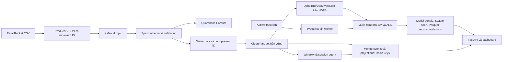

# Kiến trúc thống nhất Phase 1–7

Đây là một gói mã nguồn và dữ liệu chạy bằng Docker Compose trên một máy, có
đường đi đầy đủ từ Kafka tới API/dashboard. Mã nguồn và các bài kiểm tra cần
được phân biệt với kết quả thực thi; xem evidence và metrics của run để biết
thành phần nào đã được kiểm chứng trong môi trường bàn giao.

## Phạm vi triển khai và giới hạn thiết kế

- Lần build/chạy đầu cần Internet để tải image, hệ thống Java, Python packages
  và Kafka/Delta Maven JAR. Các wheel NumPy/SciPy trong `vendor_wheels` chỉ giảm
  một phần tải phụ thuộc, không biến toàn bộ setup thành offline.
- Compose demo dùng một broker Kafka, replication 1, Spark `local[2]`, một
  NameNode và một DataNode HDFS với replication 1. Không có high availability
  hoặc bằng chứng chịu tải của cụm nhiều máy.
- Cổng host bind vào `127.0.0.1`: API mặc định 8000, Kafka 19092, NameNode UI
  19870, Airflow tùy chọn 8088. MongoDB/Redis và job worker không công bố cổng
  host. Đây là giới hạn truy cập demo, không thay thế authentication/TLS và
  vận hành production. Gói ZIP không phải một bản triển khai cloud.
- Đường online hiện tính lại lịch sử người dùng/item bị ảnh hưởng và có bước
  duyệt clean bằng iterator; live lake xây lại snapshot xác định. Cách làm này
  ưu tiên kiểm tra được tính đúng trên demo, không hứa chi phí mỗi event cố định.
- Chỉ một writer ghi lake/projection của một run. Runner có khóa file toàn
  pipeline; live writer phải được người chạy phối hợp dừng trước retrain. Không
  chạy hai live process ghi cùng output/checkpoint.

## Đường đi dữ liệu



`pipeline.runner` thực hiện replay hữu hạn: tạo topic → producer → consumer
verify → ingest `availableNow` → feature → snapshot → lake → NoSQL → training
→ ACID check → model registry → kích hoạt latest run. Chỉ đổi
`outputs/latest_run.json` sau khi các bước bắt buộc thành công. API không gọi
Spark để train trong HTTP request.

`pipeline.streaming` là đường liên tục: ingest, feature và query
`lake_online` có checkpoint riêng. Micro-batch mới trên clean kích hoạt xây
lake và publish NoSQL. Luồng này không tự đổi model; train/retrain là một
thao tác có phiên bản riêng.

## Dữ liệu nguồn và hợp đồng sự kiện

RetailRocket được kế thừa từ Phase 1: `events.csv` có 2.756.101 dòng dữ liệu,
khoảng 94,2 MB; mẫu đi kèm có 10.000 dòng thật. Checksum/nguồn có trong
`data/metadata/`. Timestamp gốc là epoch **millisecond**, là thời gian hành vi
lịch sử, không phải đồng hồ khi chạy demo.

| Trường/cơ chế | Hợp đồng |
| --- | --- |
| CSV gốc | `timestamp,visitorid,event,itemid,transactionid` |
| JSON | `schema_version=1`, `event_id`, `run_id`, năm trường nguồn, `event_type`, `event_time`, `ingested_at`; review fields/synthetic là tùy chọn |
| Event ID | SHA-256 của JSON compact `[timestamp,visitorid,event,itemid,transactionid]`; không gồm run ID/offset/thời điểm ingest |
| Kafka key | Visitor ID, giữ cùng người dùng trên cùng partition của mỗi topic |
| `view` | Topic/event type `page_view`, trọng số 1 |
| `addtocart` | Topic/event type `add_to_cart`, trọng số 3 |
| `transaction` | Topic/event type `purchase`, trọng số 5; yêu cầu transaction ID |
| `review` | Topic/event type `review`, trọng số 0; nguồn RetailRocket gốc không có loại này |

Bốn topic có 3 partition và replication 1, retention 7 ngày. Listener nội bộ
là `kafka:29092`; listener máy host là `localhost:19092`. Thứ tự Kafka chỉ có
trong một partition, không có thứ tự thời gian toàn cục giữa topic/partition.
CSV replay cần sort trước; tốc độ phát mô phỏng không phải lưu lượng năm 2015.

Nguồn không có giá, tổng tiền đơn hàng, impressions quảng cáo hay attribution;
không thể suy ra doanh thu/AOV/CTR chuẩn. `category_tree.csv` có
`categoryid,parentid`, không có item→category. Gói không dùng tên/ảnh sản phẩm
hoặc review giả như thuộc tính nguồn thật. Fixture tổng hợp phục vụ kiểm thử
được gắn nhãn tách khỏi dữ liệu RetailRocket.

## Streaming: validation, state và snapshot

Schema JSON explicit giúp tránh drift do suy luận kiểu. Spark tính
`event_time=timestamp_millis(timestamp)` ở UTC. Dòng sai schema/ID/topic, payload
lỗi hoặc purchase thiếu transaction ID được ghi quarantine cùng lý do và
Kafka metadata. Clean giữ schema và metadata truy vết nguồn.

Dedup dùng watermark 10 phút và `dropDuplicatesWithinWatermark(event_id)`.
ID mới nhưng event quá cũ vẫn có thể bị loại; các dòng bị watermark loại được
phản ánh trong progress/state metrics, không tự được sao chép sang quarantine.
Dedup không phải cơ sở dữ liệu ID vĩnh viễn qua mọi run.

Clean Parquet là ranh giới bền vững. Window và session đọc clean bằng query
riêng thay vì nối nhiều stateful operator trong một query Spark 3.5. Mỗi sink
có checkpoint độc lập:

- Sliding window dài 5 phút, bước 1 phút; Delta `MERGE` cập nhật theo
  `visitorid,window_start,window_end` bằng giá trị tổng hiện tại.
- Session gap 30 phút; session streaming xuất sau khi watermark chốt và
  `MERGE` theo `visitorid,session_start,session_end`.
- Các đặc trưng gồm số event theo loại, interaction score, item distinct xấp
  xỉ, thời điểm đầu/cuối và `purchase_per_view`; session thêm thời lượng hoạt động.

Watermark tiến theo event time đã quan sát, không tiến chỉ vì chờ ngoài đời.
Replay hữu hạn thường còn phần đuôi window/session chưa chốt.
`phase3.snapshot` tính batch trên clean được chấp nhận, ghi riêng `snapshots/`
với nhãn `is_finite_snapshot`; snapshot không khôi phục dòng đã bị watermark
loại và không đồng nghĩa kết quả session streaming đã finalized. Một event
có thể thuộc nhiều sliding window; không cộng mọi window để suy ra tổng event.

## Delta, HDFS và các phép chiếu NoSQL

Trong Compose, `LAKE_BASE_URI=hdfs://namenode:8020/ecommerce/runs` tạo các bảng:

```text
hdfs://namenode:8020/ecommerce/runs/<run_id>/delta/
  bronze/
  silver/
  gold_interactions/
  acid_checks/<uuid>/
```

Khi không đặt `LAKE_BASE_URI`, đường lake là `outputs/runs/<run_id>/delta/` để
kiểm thử cục bộ. Clean, quarantine, checkpoint, feature streaming, model và
evidence vẫn ở bind mount `outputs/runs/<run_id>/` trên máy chạy.

Bronze lấy accepted clean, MERGE chỉ thêm event ID chưa có. Silver giữ sự kiện
hợp lệ, thêm event time/date và điểm tương tác; review được giữ với điểm 0.
Gold chỉ tổng hợp sự kiện có điểm dương theo user-item, có
`interaction_score` và `count`. Silver/Gold ghi snapshot xác định theo run.
Delta commit là nguyên tử **từng bảng**; các bảng và NoSQL không nằm trong
một distributed transaction.

MongoDB database `bigdata` lưu:

| Collection | Khóa duy nhất/phương thức |
| --- | --- |
| `events` | `(run_id,event_id)`; `$setOnInsert` + upsert |
| `user_features` | `(run_id,visitorid)`; `$set` snapshot lịch sử/seen/window |
| `item_features` | `(run_id,itemid)`; `$set` tổng hợp lịch sử |
| `sessions` | `(run_id,visitorid,session_id)`; upsert và bỏ ID projection cũ khi sự kiện trễ nối session |
| `model_registry` | `(run_id,model_version)`; phiên bản model và metadata |

Redis dùng namespace `bigdata:<run_id>:` cho seen SET, features, window,
session, stream_window, final_session và active_model. Live projection đánh
dấu `provisional=true`: session có thể đổi nếu nhận thêm sự kiện hợp lệ.
`final_session` lấy từ đầu ra session streaming đã chốt, tách khỏi session
provisional; window gần nhất của projection neo vào event cuối của user,
không được diễn giải là 5 phút theo đồng hồ hiện tại.

Mongo facts được ghi trước, projection được tính lại từ facts và ghi SET thay
vì cộng dồn. `foreachBatch` có thể chạy lại; retry hội tụ khi giữ một writer
và cùng nguồn. Có thể nhìn thấy cập nhật từng phần nếu một kho lỗi giữa các
bước; không khẳng định exactly-once xuyên Delta/Mongo/Redis.

`pipeline.acid_check` dùng namespace kiểm tra UUID riêng: ghi bảng, UPDATE,
đọc version cũ, thêm CHECK constraint, thử append chứa dòng vi phạm và xác
minh không có partial commit. Nó không đo concurrent-writer isolation hoặc
tính bền vững sau hỏng toàn cụm.

## MLlib, đánh giá thời gian và phục vụ

Training đọc Delta Silver, dedup trước khi chia thời gian; ID user/item phải
là số nguyên không âm int32. Chỉ view/cart/purchase tham gia ALS. Mỗi phần
train tự tổng hợp count và rating `view+3*cart+5*purchase`. Pipeline lưu
`VectorAssembler(view_count,cart_count,purchase_count)` cùng ALS implicit;
ALS dùng user ID/item ID/rating, không dùng vector assembler làm features.

Các mốc timestamp xấp xỉ phân vị 50%, 70%, 85% được lấy **trước tổng hợp
user-item**. Hai rolling fold lần lượt train≤50%/validate(50%,70%] và
train≤70%/validate(70%,85%]. Chọn tham số theo NDCG@K trung bình, phụ Recall@K;
train≤85% và test>85% chỉ dùng đánh giá cuối. Cold user/item được tính miss,
seen item bị loại khỏi đích ranking. Chỉ số gồm Precision/Recall/NDCG@K,
catalog/user coverage; không báo RMSE trên implicit feedback.

Sau khi đóng băng test metrics, model phục vụ được refit trên mọi sự kiện
đã quan sát. `metric_model_version` và `serving_model_version` phân biệt hai
mô hình. Recommendations toàn user được ghi Parquet, JSON xuất mặc định tối
đa 5.000 user; SQLite giữ seen của toàn bộ user đã quan sát. User ngoài phạm
vi JSON dùng popularity và vẫn lọc seen. Điểm xếp hạng không phải xác suất mua.

API tải bundle có kiểm tra schema/version; ghi model/index xong trước bundle,
đổi tên nguyên tử file JSON và chỉ kích hoạt latest sau toàn pipeline.
Cache gợi ý Redis theo run/model/user/k có TTL 60 giây. Cache hit vẫn lọc lại
seen từ bundle/SQLite/Mongo/Redis; dịch vụ hỏng được báo degraded, không giả
định lịch sử online luôn mới. Dashboard lấy KPI/model của đúng run, hiển thị
visitor purchase conversion theo distinct visitor; CTR/doanh thu để `null`.

## Điều phối và kiểm chứng

Airflow là profile `orchestration`, SequentialExecutor/SQLite cho demo. DAG
`retailrocket_daily_retrain` chạy lúc 02:00 Asia/Ho_Chi_Minh, `catchup=False`,
một active run. DAG gửi `request_id` và `quick` tới typed worker nội bộ,
không mount Docker socket hoặc nhận shell command tùy ý. Worker chỉ cho một
job active, lưu trạng thái và dùng request ID băm để chống submit trùng.
Worker retrain từ clean đã commit của latest run; lịch không tự ingest nguồn
mới. Khi worker restart giữa job, cần kiểm tra job/khóa pipeline rồi trigger
request ID mới; không tự coi job đang dở là đã hoàn thành.

Các bản ghi cần dùng khi báo cáo kết quả:

- `metrics/producer.json`, `kafka_verify.json`: ack và consumer đúng run.
- Progress Spark: offset, batch time, watermark và state metrics.
- `kpis.json`, `online_publish.json`, `acid_check.json`: lake, projections và
  kiểm tra Delta của đúng run.
- `model_metrics.json`: fold/grid, heldout, cold-start, phạm vi model phục vụ.
- `run_report.json`, `e2e_verification.json`: trạng thái toàn pipeline và đối
  chiếu API/store/model.
- `benchmark.json`: HTTP latency/requests per second với số request,
  concurrency và môi trường ghi rõ; không gọi nó là Kafka→API latency hoặc SLA.

Tham chiếu đóng góp gốc nằm trong `references/phase1` và `references/phase4`.
Không chạy các Compose cũ song song để ghép; Compose thống nhất đã quy định
phiên bản, đường dẫn và namespace cho toàn bộ Phase 1–7.

